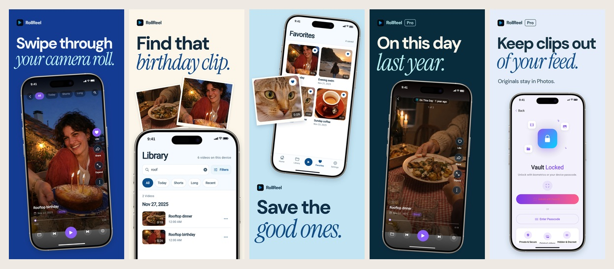

# RollReel App Store screenshots

**English, US storefront · Design handoff · November 28, 2026**

The creative hypothesis is that a recognizable memory gives someone a reason to reopen their camera roll. The sequence follows a rooftop birthday from the player into search and Favorites, then shows two choices available with Pro. The current listing establishes what RollReel does. These images show what someone would actually use it for.

| Order | Headline | What to look for |
|---|---|---|
| 1 | Swipe through your camera roll. | A friend laughs as the cake arrives. The visible playback controls establish that this is a video in RollReel. |
| 2 | Find that birthday clip. | Two prints give “roof” a context. The real Library screen returns Rooftop dinner and Rooftop birthday. |
| 3 | Save the good ones. | The same birthday appears among four saved clips. The cat detail enlarges a tile directly from the Favorites capture, including its selected heart. |
| 4 | On this day last year. | The Pro label precedes a past-year video. The player displays its own “On This Day · 1 year ago” header. |
| 5 | Keep clips out of your feed. | The Pro Vault screen shows the unlock options. “Originals stay in Photos” sets the scope of the lock. |

## Files and placement

Use the five numbered PNGs in filename order. The contact sheet above is a review image.

| Directory | Canvas | Depicted hardware |
|---|---|---|
| [Native iPhone 16 Pro artwork](en-US/iphone-16-pro/) | 1206 × 2622 px, portrait | iPhone 16 Pro, natural titanium |
| [Large iPhone canvas](en-US/large-iphone-canvas/) | 1320 × 2868 px, portrait | The same iPhone 16 Pro composition on a larger canvas |

Each file is an opaque, sRGB-tagged PNG. The native screen is 402 × 874 points at 3×. The model-specific frame has a 1350 × 2760 px source and a 1206 px screen opening at +72, +69. The large export is rendered with uniform scale. fastlane's upload-size table recognizes both output dimensions. Apple's specifications page returned HTTP 403 in this environment. Verify the display slots offered for this release in App Store Connect. An iPad listing needs a separate iPad composition. [Frame and offsets](https://github.com/fastlane/frameit-frames/tree/050cc1ffe1e730429199f478061cd8da16fa9680/latest) · [fastlane size table](https://github.com/fastlane/fastlane/blob/c66165c23eee1c6471bc617bb3c3513bb36f6132/deliver/lib/deliver/app_screenshot.rb) · [Apple screenshot specifications](https://developer.apple.com/help/app-store-connect/reference/app-information/screenshot-specifications/)

## Capture and release handoff

The product screens use the Flutter widgets from RollReel revision `f12f6d6` rendered at 1206 × 2622 in an isolated web capture. The capture supplies local media, favorites, dates, and a Pro account state. The birthday portrait is original generated illustrative media. Dinner and coastal imagery come from RollReel's bundled onboarding art. The cat and coffee fixtures match the scikit-image originals pixel for pixel. Stefan van der Walt released the cat image under CC0, and Rachel Michetti released the coffee image under CC0. The store typography uses DM Sans and Instrument Serif Italic. The bezel, status indicators, and home indicator are presentation layers. [Photo credits](https://github.com/scikit-image/scikit-image/blob/2b5601b68184d66b241eb6c94286918452f0cf3c/src/_skimage2/data/_fetchers.py)

Before publishing, compare each panel with the intended iOS release on an iPhone 16 Pro or its Simulator. Check the system chrome, fonts, safe areas, search results, saved state, memory date, and Vault authentication labels. Confirm publication rights for the existing media or replace it with owner-cleared clips. Native captures can replace the screen layer. When they include system chrome, use it once. App Store Connect acceptance and conversion performance remain unmeasured.

The reusable procedure is included as an installable Codex skill in Markdown. [App Store screenshot skill](APP_STORE_SCREENSHOT_SKILL.md)
